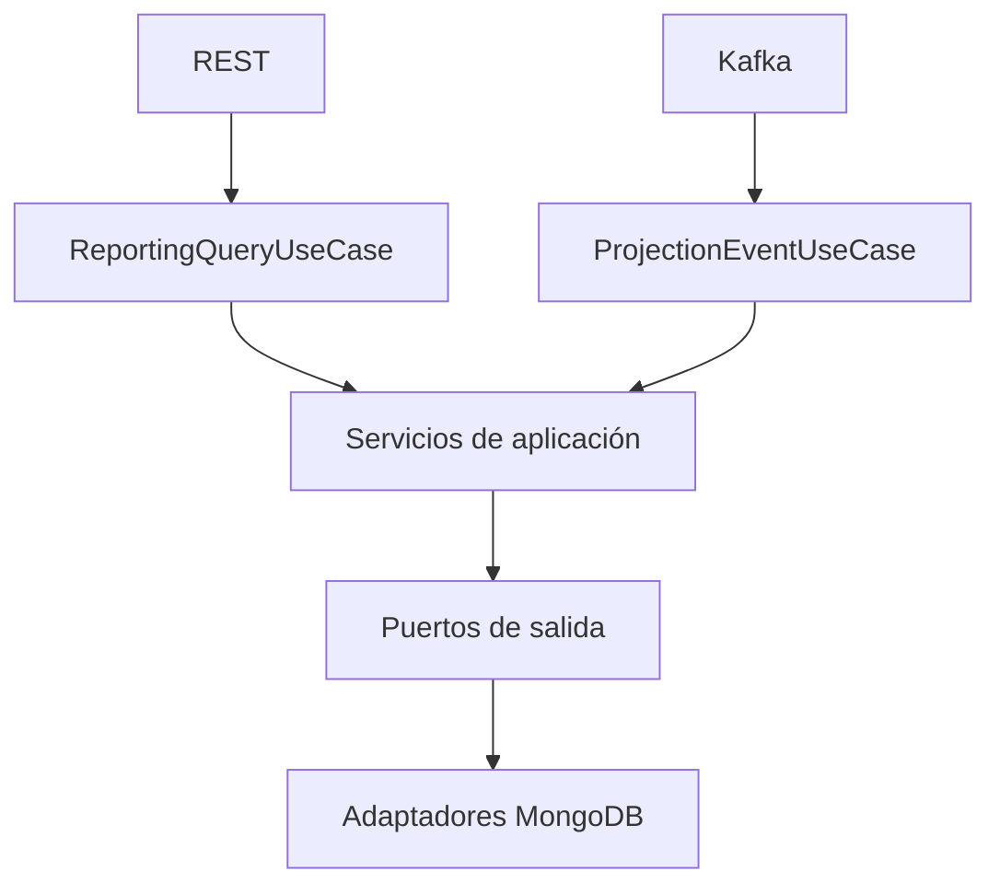

# Arquitectura hexagonal

## Dominio

`domain/model` contiene las proyecciones y métricas sin importar Quarkus,
MongoDB, Kafka o Jakarta REST.

## Aplicación

- `application/port/in`: casos de uso que invocan REST y Kafka.
- `application/port/out`: necesidades de consulta, estadísticas y escritura.
- `application/service`: reglas de paginación, rangos, enriquecimiento y
  transformación de eventos.
- `application/command` y `application/model`: datos internos de cada caso de
  uso, independientes de los DTO externos.

## Adaptadores de entrada

- `adapter/in/rest`: conserva la API HTTP y convierte DTO a modelos internos.
- `adapter/in/messaging`: deserializa los contratos Kafka y los convierte en
  comandos de aplicación. Usa `@Blocking` porque MongoDB Panache es bloqueante.

## Adaptadores de salida

- `MongoConsultationQueryAdapter`: búsqueda paginada y combinable.
- `MongoDashboardQueryAdapter`: aggregation pipelines del dashboard.
- `MongoProjectionWriteAdapter`: proyecciones idempotentes y tolerantes al
  desorden de eventos.
- `appointment_view`: vista reconstruible del ciclo de vida de las citas.
- `adapter/out/mongodb/document`: documentos exclusivos de persistencia.
- `db/changeLog.xml`: evolución versionada mediante Liquibase MongoDB.

## Infraestructura

`ApplicationBeanConfiguration` conecta puertos con servicios sin poner
anotaciones de framework en aplicación o dominio. La extensión de Liquibase
MongoDB ejecuta el changelog antes de recibir tráfico.

